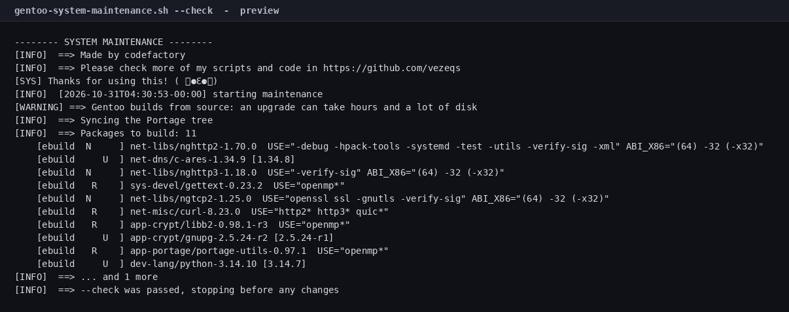

# Gentoo System Maintenance Script

[](LICENSE)
[](#tested-on)

One command to sync, update, clean and repair Gentoo. It shows you the build
plan, **asks before touching anything**, and tells you if a reboot is needed.

> **Gentoo builds from source.** A world update can take hours and a lot of disk.
> Run it with `--check` first, read the plan, and only then decide.



## Quick start

```bash
git clone https://github.com/vezeqs/gentoo-system-maintenance.git
cd gentoo-system-maintenance

# 1. sync and read the plan, change nothing
sudo ./gentoo-system-maintenance.sh --check

# 2. run it for real
sudo ./gentoo-system-maintenance.sh
```

## What it does

| # | Step | Command |
|---|------|---------|
| 1 | Sync the Portage tree | `emerge --sync`, falling back to `emerge-webrsync` |
| 2 | Show the build plan | `emerge -puDN @world`, `emerge --depclean --pretend` |
| 3 | **Stop here with `--check`** | no changes |
| 4 | **Ask for confirmation** | `Proceed? [y/N]` |
| 5 | Rebuild preserved libraries | `emerge @preserved-rebuild` |
| 6 | Check reverse dependencies | `revdep-rebuild` (gentoolkit) |
| 7 | Update the world set | `emerge -uDN @world --keep-going` |
| 8 | Remove packages nothing needs | `emerge --depclean` |
| 9 | Clean distfiles and logs | `eclean-dist --destructive` (gentoolkit) or `emerge --clean` |
| 10 | Check for a pending reboot | `/usr/src/linux` vs `uname -r` |

## Why `--check` exists

On Gentoo the preview is the expensive part: dependency resolution can take
minutes, and the build that follows can take hours. `--check` runs the sync and
the pretend update, prints the package list, and exits before anything is built
or removed. It is the safe way to answer "how bad is this update?".

## The confirmation prompt

Nothing is built or removed until you answer `y`. Before asking, the script
prints how many packages would be built, the first ten of them, and how many
packages depclean would remove:


Answer anything but `y` and it exits with `nothing was changed`.

## Options

| Flag | Effect |
|------|--------|
| `-y`, `--yes` | Skip the confirmation prompt (cron, unattended runs) |
| `-n`, `--dry-run` | Print every command without running it |
| `--check` | Sync, print the plan, then stop before building |
| `-h`, `--help` | Show usage |

Without `-y`, the script refuses to run if there is no terminal to confirm on,
so a cron job fails loudly instead of building silently.

## Example

A real `--check` against a `gentoo/stage3` container: the tree synced and the
plan came back with 11 packages to build, including Python 3.14.10, GnuPG and a
curl rebuild with HTTP/3.


## Requirements

- Gentoo
- root (`sudo`)
- Bash 4.0+ (default everywhere)
- `gentoolkit` is optional, for `revdep-rebuild` and `eclean-dist`
- network access to a Portage mirror, or a working `emerge-webrsync`

## Safety notes

- **A world update builds from source.** Expect hours on a slow machine, and
  make sure `/var/tmp/portage` has room.
- **`--keep-going` keeps building after a failure.** You get a report at the end
  instead of stopping at the first broken package, but you must read it.
- **`emerge --depclean` removes packages nothing depends on.** The pretend run
  is shown in the preview; check it before confirming.
- **`eclean-dist --destructive` deletes old distfiles.** They can be downloaded
  again, but not for free.
- **`--dry-run` never changes anything**, including the preview queries.
- **Fails fast.** `set -euo pipefail` plus an `ERR` trap that reports the failing
  command and its exit status.

## Tested on

| Image | Result |
|-------|--------|
| `gentoo/stage3` | `--check` synced the Portage tree and produced a plan of 11 packages |
| `gentoo/stage3` + mock `emerge` | command sequence: sync, pretend, preserved-rebuild, world update, depclean, clean |

The full `emerge -uDN @world` was **not** run: it builds Python and a toolchain
from source, which is hours of work inside a container. The build path is the
same code that `--check` previews, but it has not been executed end to end here.

## Verify it yourself

```bash
make check
```

`make check` runs `bash -n`, shellcheck when installed, the smoke tests and the
asset check. The screenshot comes from a real `gentoo/stage3` container:

`tests/assets.sh` also verifies `assets/source.sha256`: if the script changes without regenerating the screenshots, `make check` fails.

```bash
podman run --rm -v "$PWD:/repo:ro,Z" gentoo/stage3 \
  bash /repo/gentoo-system-maintenance.sh --check
```

`make container-test` runs the container/mock test (needs podman).

## Limits

- It does not run a full world build in the repository's tests. That is hours of
  compilation; `--check` proves the sync, dependency resolution and plan, and
  `tests/emerge_runtime.sh` proves the command sequence with a mock `emerge`.
- It does not manage profiles, USE flags, binhosts or kernel rebuilds.
- It does not replace `eselect` or `dispatch-conf`.
- `eclean-dist --destructive` needs `gentoolkit`; without it the distfiles step
  is skipped.

## License

MIT — see [LICENSE](LICENSE).

## Author

**codefactory** — [github.com/vezeqs](https://github.com/vezeqs)
